<div align="center">


# Markdown Word

**Word 式所见即所得 Markdown 编辑器 · VS Code 扩展**

像用 Word 一样写 Markdown——两行图标化 Ribbon、可视化表格、斜杠命令菜单、
Copilot AI 助手、公式 / 流程图 / 代码高亮、页面设置、中英双语界面。

[](https://code.visualstudio.com/)
[](#开发与测试)
[](#许可证)
[](CHANGELOG.md)

**磁盘上永远是标准 Markdown** —— 可视化编辑零语法妥协，往返保真。

📧 作者：[emonzhang3438@outlook.com](mailto:emonzhang3438@outlook.com) · 有任何 Bug 或需求欢迎提出

简体中文 · [English](#markdown-word-english)

</div>

---


打开任意 `.md` 文件即是 Word 式编辑体验：纸张居中、实时渲染、自动保存。
中英文自动分设字体（Segoe UI × 微软雅黑），正文与代码各用其字体。

## 目录

- [安装](#安装)
- [功能巡礼](#功能巡礼)
  - [三模式编辑](#1-三模式编辑)
  - [两行图标化 Ribbon](#2-两行图标化-ribbon)
  - [可视化表格](#3-可视化表格)
  - [斜杠命令菜单](#4-斜杠命令菜单)
  - [代码高亮（含 PL/SQL）](#5-代码高亮含-plsql)
  - [数学公式](#6-数学公式)
  - [Mermaid 流程图](#7-mermaid-流程图)
  - [Draw.io 集成](#8-drawio-集成)
  - [AI 助手（GitHub Copilot）](#9-ai-助手github-copilot)
  - [查找替换](#10-查找替换)
  - [大纲视图与面包屑](#11-大纲视图与面包屑)
  - [页面设置与外观](#12-页面设置与外观)
  - [图片粘贴持久化](#13-图片粘贴持久化)
  - [智能粘贴](#14-智能粘贴)
  - [脚注 · 目录 · 提示面板](#15-脚注--目录--提示面板)
  - [Emoji 面板与最近使用](#16-emoji-面板与最近使用)
  - [界面中英文](#17-界面中英文)
  - [导出 HTML / PDF](#18-导出-html--pdf)
  - [暗色主题](#19-暗色主题)
- [快捷键](#快捷键)
- [设置项](#设置项)
- [已知限制](#已知限制)
- [开发与测试](#开发与测试)
- [作者与反馈](#作者与反馈)
- [许可证](#许可证)

## 安装

**方式一：VSIX 安装（推荐）**

```bash
code --install-extension wysiwyg-markdown-editor-1.8.1.vsix
```

或在扩展面板 → `···` → **从 VSIX 安装...**。

**方式二：源码运行**

```bash
git clone https://github.com/Emon9426/VSCodeMarkDownEditor.git
code VSCodeMarkDownEditor   # 打开后按 F5 启动扩展开发主机
```

安装后首次打开 `.md` 文件即进入 Word 式编辑器（若仍以文本编辑器打开：
文件标签页右键 → **重新打开编辑器方式...** → 选择 *Markdown Word 编辑器* 并设为默认）。

## 功能巡礼

### 1. 三模式编辑

**所见即所得 / 源码 / 分屏** 三种模式随时切换（状态栏一键循环，或 Ribbon「视图」页签）。
源码与分屏模式的纸张宽度与页面模式严格一致——切换无跳变。

| 模式 | 说明 |
|---|---|
| 所见即所得 | 直接编辑渲染后的文档，所有格式即时生效 |
| 源码 | 等宽字体编辑 Markdown 源码，可与原生编辑器并排（提示条链接） |
| 分屏 | 左源码右渲染，滚动同步 |

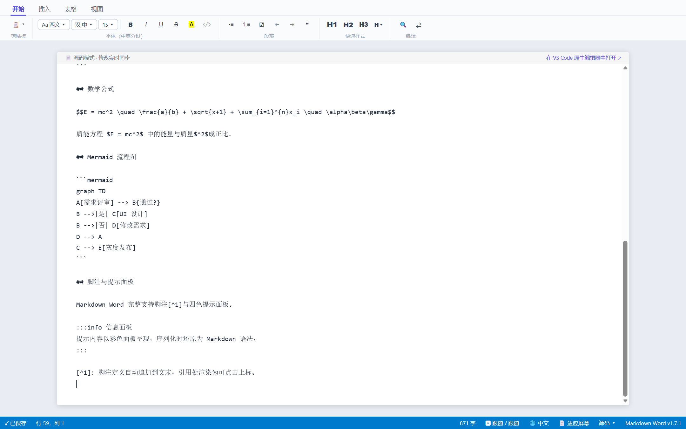

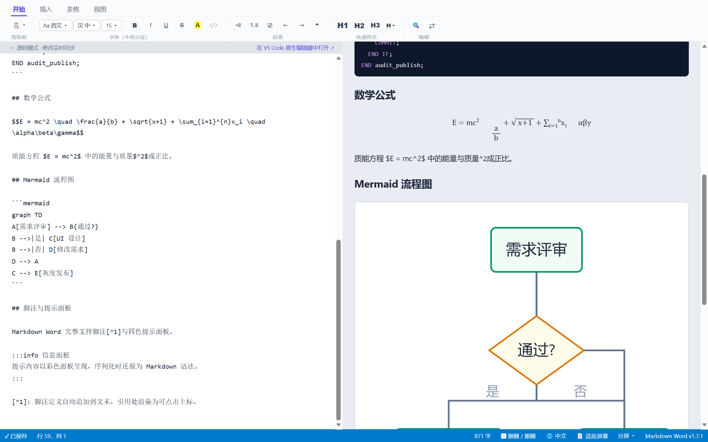

### 2. 两行图标化 Ribbon

页签行（开始 / 插入 / 表格 / 表格工具 / 视图）+ 单行工具组，恒定两行不折行，
全部图标化并带中文 tooltip 与快捷键提示。


### 3. 可视化表格

- **网格选择器**：像 Word 一样拖选行列即插入；
- **表格上下文工具条**：光标进入表格自动出现——增删行列、合并、对齐、移动行列；
- 单元格内支持 `\|` 转义、`Tab` / `Enter` 跳格（末格自动续行）。

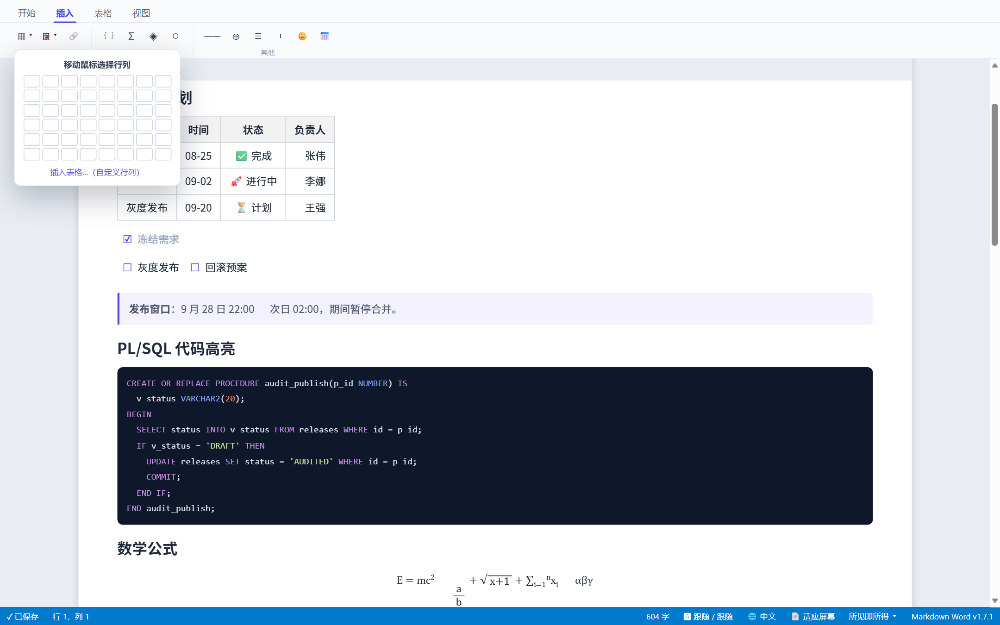

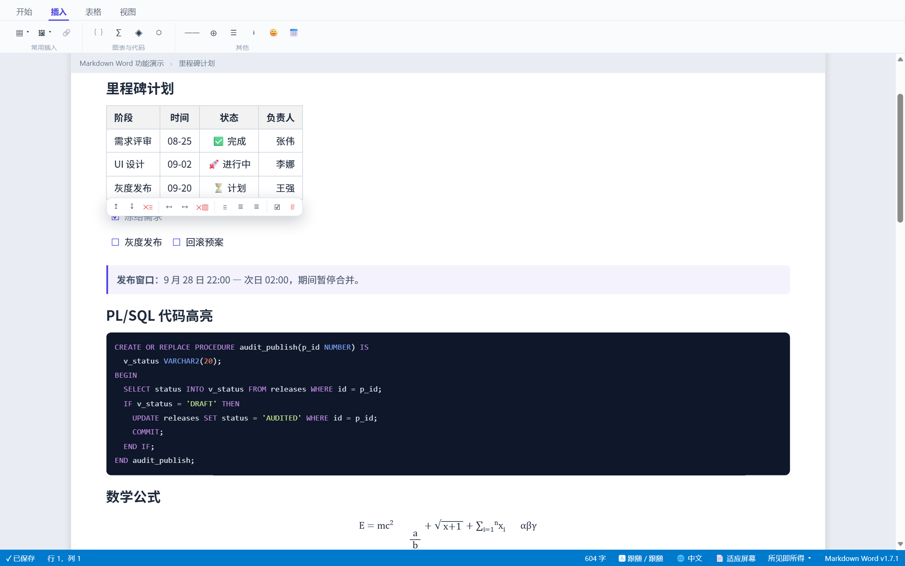

### 4. 斜杠命令菜单

Confluence 习惯：正文任意位置输入 `/` 唤出分组菜单（AI / 基础块 / 列表 / 媒体与插入 / Emoji），
关键词过滤 + 拼音速记（如 `/biaoge` → 表格），回车插入。

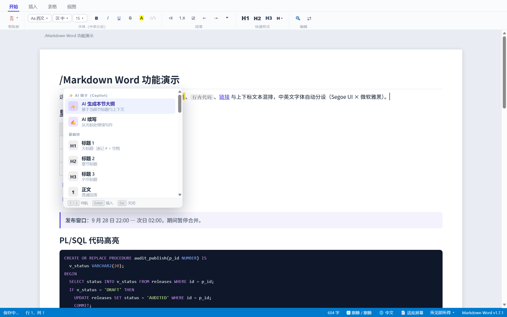

### 5. 代码高亮（含 PL/SQL）

自研零依赖高亮器，30+ 语言：关键字 / 类型 / 字符串 / 注释 / 数字着色，
**PL/SQL 与 T-SQL 专项支持**（大小写不敏感关键字、`CREATE PROCEDURE` 等）。
代码块与行内代码恒为等宽字体（Consolas，可配置），语言可随时切换重高亮。

```text
支持语言（节选）：plsql tsql javascript typescript python java c cpp csharp
go rust php ruby swift kotlin scala sql xml yaml json html css bash powershell diff …
```

### 6. 数学公式

自研 LaTeX 子集渲染器（零外部依赖）：

- 块级 `$$...$$` 与行内 `$...$`；
- 分数 `\frac`、根号 `\sqrt`（含 n 次方根）、上下标（含 `{}` 组）、
  60+ 符号（∑ ∫ ≤ ≠ → α β γ …）、`\text`、`\overline / \vec / \hat`；
- **双击公式** 弹出 LaTeX 源码编辑对话框，实时重渲染；
- 行内公式仅渲染无空格内容——写 `$100` 不会被误当成公式。

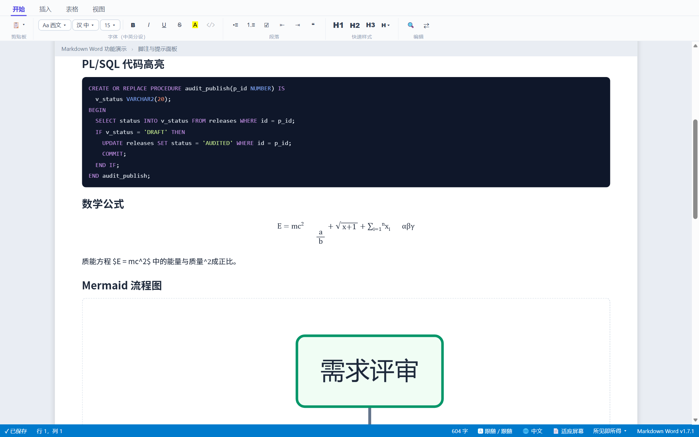

### 7. Mermaid 流程图

自研 `graph TD / LR` 子集渲染为 SVG：方框 `[]` / 圆角 `()` / 菱形 `{}` 节点、
四种边型、边标签；拓扑分层 + 折线布局。**双击图表编辑源码**；
不支持的语法（如时序图）自动降级为源码显示，不会破坏文档。
Ribbon「插入 → ◈」即插入模板并弹出编辑对话框。

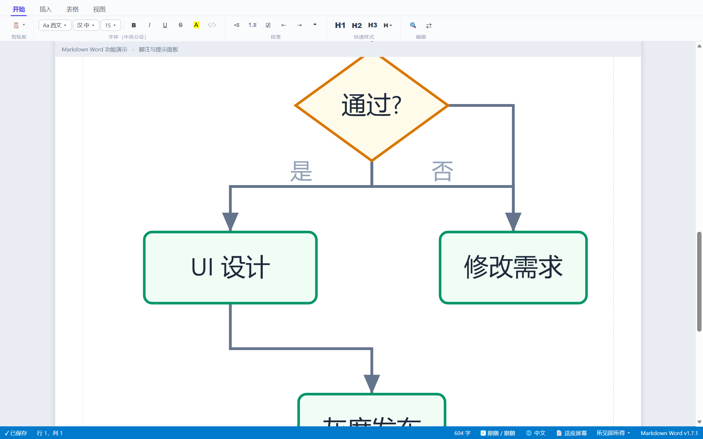

### 8. Draw.io 集成

Ribbon「插入 → ⬡」在文档目录 `diagrams/` 下创建 `.drawio.svg` 模板并插入引用；
右键图片 → **用 Draw.io 编辑**（需安装 [vscode-drawio](https://marketplace.visualstudio.com/items?itemName=hediet.vscode-drawio)）
并排打开编辑，保存即更新。`.drawio.svg` 为标准图片语法，GitHub 原生渲染。

### 9. AI 助手（GitHub Copilot）

复用 VS Code 已登录的 Copilot（官方 `vscode.lm` API），**零二次登录、零密钥配置**：

- **选区 AI**：选中文字出现 ✨ 浮动条——改写 / 润色 / 扩写 / 缩写 / 中英互译 / 修正错别字 / 自定义指令；
  结果卡显示原文删除线与流式新文，可接受替换 / 重试 / 追加指令 / 放弃；
- **斜杠 AI**：`/AI大纲`（基于标题脉络生成本节大纲）、`/AI续写`（光标处续写）；
- 未登录或 API 不可用时优雅提示；`markdownWord.ai.enabled` 可整体关闭，`ai.model` 可选模型。

### 10. 查找替换

`Ctrl+F` / `Ctrl+H`：大小写、正则开关，命中计数，Enter / Shift+Enter 上下导航，
替换当前 / 全部替换。高亮基于 **CSS Custom Highlight API**——零 DOM 污染，
不影响序列化与保存。

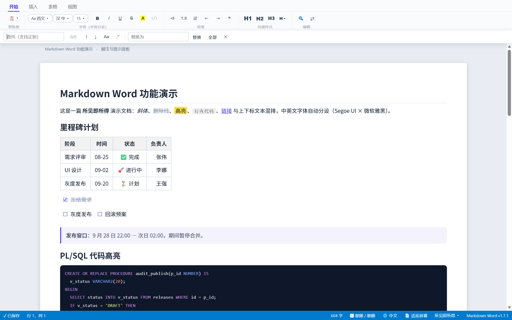

### 11. 大纲视图与面包屑

- **活动栏独立入口**（🗂 图标）：标题层级树（H1–H6）随编辑实时刷新，
  点击任意标题跳转正文并闪烁高亮；
- **面包屑**：编辑区顶部粘性标题路径，光标在正文段落也正确显示所属章节链，点击层级跳转。

### 12. 页面设置与外观

状态栏 📄 或 Ribbon「视图 → 页面」：

- **纸张尺寸**：适应屏幕（默认，最宽 1200px）/ A3 / A4 / A5 / B5 / Letter / Legal / 自定义，
  切换后内容**纯 CSS 流式重排**（换行、表格收缩、代码块横滚）；
- **页面背景**：跟随主题 / 护眼绿 / 羊皮纸 / 冰蓝 / 自定义色（各含暗色变体）；
- **条纹**：无 / 横线 / 方格 / 点阵（间距对齐行高）；
- 全部为视图层设置、工作区持久化、**零写入 Markdown 源文件**。

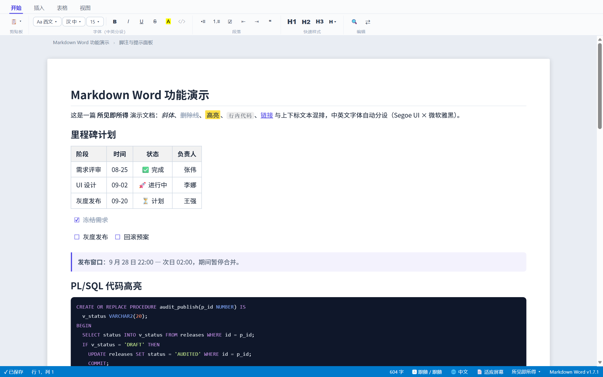

### 13. 图片：粘贴持久化 + 拖拽缩放 + 表格内嵌图

- `Ctrl+V` 粘贴截图自动落盘（默认 `./images/文档名-时间戳.png`，可配置目录与命名），
  以相对路径引用——**临时 blob 永不写入**，换机器不丢图；支持本地文件拖拽、文件管理器复制粘贴、多图一次粘贴；
- **点击图片 → 拖动右下角手柄调整尺寸**（等比缩放，宽度持久化为 ``，
  GitHub / VS Code 预览原生渲染；未调整过的图片保持纯 `` 语法）；
- **图片对齐**：选中图片时浮动工具条一键切换**左对齐 / 居中 / 右对齐**——段落内相对纸张、
  表格单元格内相对该单元格（持久化为 ``，GitHub 兼容）；
- **图片可放入表格单元格**（行内呈现、防撑破列宽，同样支持粘贴与缩放）；
- 本地图片自动解析为可显示资源；图片丢失时红虚线提示。

### 14. 智能粘贴

从 **Word**（含 `mso-list` 嵌套列表）、**Excel**、**网页** 复制的内容自动转换为 Markdown
（保留标题、粗斜体、表格、列表层级）；从其他 Markdown 源复制时自动渲染。
表格 / 列表 / 代码块内部粘贴纯文本，避免格式爆炸。

### 15. 脚注 · 目录 · 提示面板

- **脚注**：`[^1]` 引用渲染为可点击上标，定义块自动追加文末；Ribbon 一键插入自动编号；
- **目录 TOC**：按当前标题层级一键生成；
- **提示面板**：四色（信息 / 提示 / 警告 / 错误）面板，序列化还原为 Markdown 语法。

### 16. Emoji 面板与最近使用

Ribbon 与斜杠菜单共用 Emoji 面板（分类 + 搜索），
**最近使用的 Emoji 自动置顶**（最多 24 个，工作区持久化，两入口同步）。

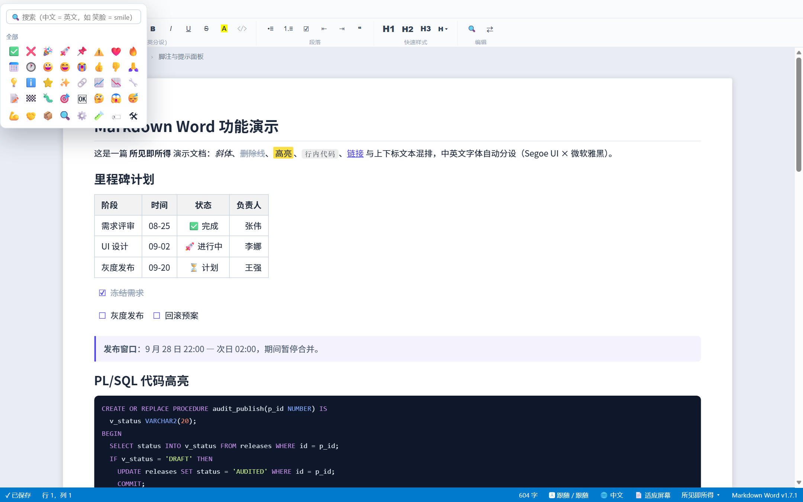

### 17. 界面中英文

`markdownWord.ui.language`（`auto` / `zh-CN` / `en`）或状态栏 🌐 一键切换，即时生效。
覆盖 Ribbon tooltip、菜单、对话框、查找条、AI 卡、右键菜单等核心字符串。

### 18. 导出 HTML / PDF

- **导出 HTML**：自包含单文件（样式 + 高亮内联），可直接分发；
- **导出 PDF**：生成 `@page` 打印就绪页面并在浏览器打开（Ctrl+P → 另存为 PDF），
  采用当前页面设置中的纸张尺寸。

### 19. 暗色主题

完整跟随 VS Code 主题（CSS 变量），暗色下页面背景 / 面板 / 高亮均有专属配色。

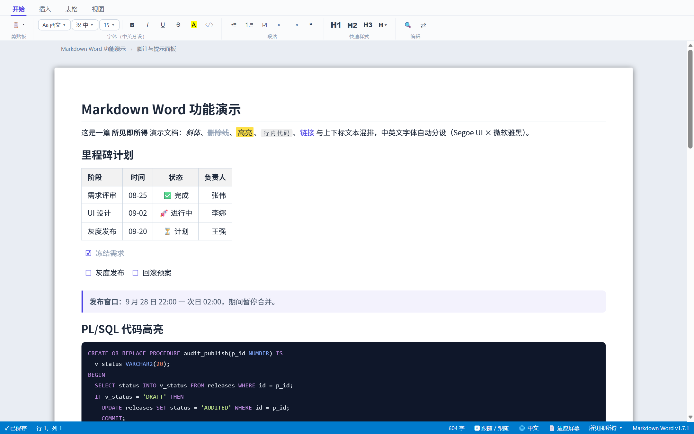

## 快捷键

| 快捷键 | 功能 |
|---|---|
| `Ctrl+F` / `Ctrl+H` | 查找 / 替换 |
| `Ctrl+B` / `Ctrl+I` / `Ctrl+U` | 粗体 / 斜体 / 下划线 |
| `Ctrl+1` … `Ctrl+6` | 标题 1–6 |
| `Ctrl+Shift+K` | 代码块 |
| `Ctrl+K` | 插入链接 |
| `Ctrl+Alt+T` | 插入表格（网格选择器） |
| `Ctrl+Alt+V` | 循环切换编辑模式 |
| `Ctrl+Shift+7 / 8 / 9` | 有序 / 无序 / 任务列表 |
| `Ctrl+Shift+Q` | 引用块 |
| `Tab` / `Shift+Tab` | 增 / 减缩进（表格内跳格） |
| `/` | 斜杠命令菜单 |
| `Esc` | 关闭浮层 |

## 设置项

| 设置 | 默认 | 说明 |
|---|---|---|
| `markdownWord.defaultMode` | `wysiwyg` | 打开文档的默认模式（`wysiwyg` / `source` / `split`） |
| `markdownWord.editor.fontFamilyLatin` | 跟随 | 西文字体 |
| `markdownWord.editor.fontFamilyCJK` | 跟随 | 中文字体（微软雅黑 / 宋体 / 楷体 / 思源黑体 / 霞鹜文楷…） |
| `markdownWord.editor.fontSize` | `15` | 正文字号 |
| `markdownWord.editor.codeFontFamily` | `Consolas` | 代码块 / 行内代码等宽字体 |
| `markdownWord.image.saveFolder` | `./images` | 粘贴图片保存目录 |
| `markdownWord.image.fileNamePattern` | `${docName}-${timestamp}` | 图片命名模式 |
| `markdownWord.slashMenu.enabled` | `true` | 斜杠菜单开关 |
| `markdownWord.table.defaultHeader` | `true` | 新表默认表头行 |
| `markdownWord.page.size` | `fit` | 纸张尺寸（`fit` / `a3` / `a4` / `a5` / `b5` / `letter` / `legal` / `custom`） |
| `markdownWord.page.background` | `auto` | 页面背景（预设名或 `#RRGGBB`） |
| `markdownWord.page.pattern` | `none` | 条纹（`lines` / `grid` / `dots`） |
| `markdownWord.ai.enabled` | `true` | AI 助手总开关 |
| `markdownWord.ai.model` | 自动 | 指定 Copilot 模型 |
| `markdownWord.ui.language` | `auto` | 界面语言 |

字体、页面等文档级设置同时持久化到**工作区**（同一项目自动恢复），不写入 Markdown 源文件。

## 已知限制

- 原生 PDF 生成暂以「打印路径」交付（浏览器打印对话框），字体内嵌待后续；
- 代码块暂无行号；
- 上标 / 下标 / 清除格式按钮待实现（实现前不放占位按钮）；
- Mermaid 支持子集（`graph TD/LR`），时序图等暂降级为源码显示；
- AI 需 VS Code ≥ 1.95 且已登录 GitHub Copilot。

## 开发与测试

```bash
npm test            # 201 项自动化测试
npm run package     # 打包 vsix
```

测试体系：stub 冒烟 → 核心引擎单测 → jsdom 真实 DOM 集成 → 宿主侧（vscode stub）链路 →
多视口 UI 稳定性（320–1920px 浮层钳制 / 压力 / 恶意输入）→ CDP 真实 Chromium 视口断言 →
性能基准（50/200KB parse/roundtrip 防回退）。

README 截图由流水线自动生成：`node scripts/build-shots.js` 生成演示页，
配合 Edge headless（CDP 端口 9333）运行 `node scripts/take-shots.js` 批量截图。

需求规格、UI 设计与实现进度跟踪见 [需求与UI设计文档.html](需求与UI设计文档.html)（浏览器打开评审），
版本历史见 [CHANGELOG.md](CHANGELOG.md)。

## 作者与反馈

📧 **作者**：[emonzhang3438@outlook.com](mailto:emonzhang3438@outlook.com)

- 发现 **Bug**：请邮件告知（附上复现步骤与截图更佳），或直接提 [Issue](https://github.com/Emon9426/VSCodeMarkDownEditor/issues)；
- 有 **新需求 / 功能建议**：同样欢迎提出——本项目的需求文档（[需求与UI设计文档.html](需求与UI设计文档.html)）会持续收录与跟踪每一项反馈；
- 也欢迎 PR 共同完善。

## 许可证

MIT

---

<div align="center">

# Markdown Word (English)

**A Word-style WYSIWYG Markdown editor · VS Code extension**

Write Markdown the way you use Word — two-row icon Ribbon, visual tables,
slash commands, a Copilot AI assistant, formulas / diagrams / syntax highlighting,
page setup, and a bilingual (Chinese/English) UI.

[](https://code.visualstudio.com/)
[](#development--testing)
[](#license)
[](CHANGELOG.md)

**The file on disk is always plain, standard Markdown** — visual editing with zero syntax compromise, lossless round-trip.

📧 Author: [emonzhang3438@outlook.com](mailto:emonzhang3438@outlook.com) · Bug reports and feature requests are always welcome

[简体中文](#markdown-word) · English

</div>

---


Open any `.md` file and get a Word-like experience: centered paper, live rendering, auto-save.
Latin and CJK text each get their own font (Segoe UI × Microsoft YaHei); code always uses a monospace font.

## Table of Contents

- [Installation](#installation)
- [Feature Tour](#feature-tour)
  - [Three editing modes](#1-three-editing-modes)
  - [Two-row icon Ribbon](#2-two-row-icon-ribbon)
  - [Visual tables](#3-visual-tables)
  - [Slash command menu](#4-slash-command-menu)
  - [Syntax highlighting (incl. PL/SQL)](#5-syntax-highlighting-incl-plsql)
  - [Math formulas](#6-math-formulas)
  - [Mermaid diagrams](#7-mermaid-diagrams)
  - [Draw.io integration](#8-drawio-integration)
  - [AI assistant (GitHub Copilot)](#9-ai-assistant-github-copilot)
  - [Find & Replace](#10-find--replace)
  - [Outline view & breadcrumbs](#11-outline-view--breadcrumbs)
  - [Page setup & appearance](#12-page-setup--appearance)
  - [Persistent image paste](#13-persistent-image-paste)
  - [Smart paste](#14-smart-paste)
  - [Footnotes · TOC · callout panels](#15-footnotes--toc--callout-panels)
  - [Emoji panel with recents](#16-emoji-panel-with-recents)
  - [Bilingual UI](#17-bilingual-ui)
  - [Export HTML / PDF](#18-export-html--pdf)
  - [Dark theme](#19-dark-theme)
- [Keyboard Shortcuts](#keyboard-shortcuts)
- [Settings](#settings)
- [Known Limitations](#known-limitations)
- [Development & Testing](#development--testing)
- [Author & Feedback](#author--feedback)
- [License](#license)

## Installation

**Option 1: Install from VSIX (recommended)**

```bash
code --install-extension wysiwyg-markdown-editor-1.8.1.vsix
```

Or via the Extensions panel → `···` → **Install from VSIX...**.

**Option 2: Run from source**

```bash
git clone https://github.com/Emon9426/VSCodeMarkDownEditor.git
code VSCodeMarkDownEditor   # press F5 to launch the Extension Development Host
```

After installing, opening any `.md` file enters the Word-style editor. If it still opens in the plain text editor:
right-click the file tab → **Reopen Editor With...** → choose *Markdown Word 编辑器* and set it as default.

## Feature Tour

### 1. Three editing modes

**WYSIWYG / Source / Split** — switch anytime (status bar cycles modes, or the Ribbon *View* tab).
Source and split modes use exactly the same paper width as page mode, so switching never jumps.

| Mode | Description |
|---|---|
| WYSIWYG | Edit the rendered document directly; every format applies instantly |
| Source | Edit Markdown source in a monospace font; can open beside the native editor (link in the hint bar) |
| Split | Source on the left, rendered preview on the right, scroll-synced |


### 2. Two-row icon Ribbon

Tab row (Home / Insert / Table / Table Tools / View) plus a single row of tool groups — always two rows, never wraps.
Every button is an icon with a localized tooltip including its shortcut.


### 3. Visual tables

- **Grid picker**: hover to select rows × columns and insert, just like Word;
- **Contextual table toolbar**: appears when the cursor enters a table — insert/delete rows & columns, align, move rows/columns;
- `\|` escaping inside cells, `Tab` / `Enter` cell navigation (auto-continues a row at the last cell).


### 4. Slash command menu

Confluence-style: type `/` anywhere in a paragraph to summon a grouped menu (AI / Basic blocks / Lists / Media & Insert / Emoji),
with keyword filtering and pinyin shortcuts (e.g. `/biaoge` → table). Enter inserts.


### 5. Syntax highlighting (incl. PL/SQL)

A self-built, zero-dependency highlighter covers 30+ languages: keywords / types / strings / comments / numbers,
with **dedicated PL/SQL and T-SQL support** (case-insensitive keywords, `CREATE PROCEDURE`, …).
Code blocks and inline code always use a monospace font (Consolas, configurable); switch languages anytime to re-highlight.

```text
Selected languages: plsql tsql javascript typescript python java c cpp csharp
go rust php ruby swift kotlin scala sql xml yaml json html css bash powershell diff …
```

### 6. Math formulas

A self-built LaTeX-subset renderer (zero external dependencies):

- Block `$$...$$` and inline `$...$`;
- Fractions `\frac`, radicals `\sqrt` (incl. n-th root), super/subscripts (with `{}` groups),
  60+ symbols (∑ ∫ ≤ ≠ → α β γ …), `\text`, `\overline / \vec / \hat`;
- **Double-click a formula** to open a LaTeX source dialog with live re-rendering;
- Inline math only renders space-free content — `$100` stays a price, not a formula.


### 7. Mermaid diagrams

A self-built `graph TD / LR` subset rendered to SVG: rect `[]` / rounded `()` / diamond `{}` nodes,
four edge styles, edge labels; topological layering with orthogonal routing. **Double-click a diagram to edit its source**;
unsupported syntax (e.g. sequence diagrams) falls back to showing the source — the document is never broken.
Ribbon *Insert → ◈* inserts a template and opens the editor dialog.


### 8. Draw.io integration

Ribbon *Insert → ⬡* creates a `.drawio.svg` template under `diagrams/` in the document folder and inserts a reference;
right-click the image → **Edit with Draw.io** (requires the [vscode-drawio](https://marketplace.visualstudio.com/items?itemName=hediet.vscode-drawio) extension)
opens it side by side; saving updates the image. `.drawio.svg` uses standard image syntax and renders natively on GitHub.

### 9. AI assistant (GitHub Copilot)

Reuses the Copilot session already signed into VS Code (official `vscode.lm` API) — **no second login, no API keys**:

- **Selection AI**: select text to reveal the ✨ floating bar — rewrite / polish / expand / condense / translate Chinese↔English / fix typos / custom instruction;
  the result card shows the original struck through plus streaming new text — accept / retry / follow-up / discard;
- **Slash AI**: `/AI大纲` (outline for the current section based on heading context), `/AI续写` (continue writing at the cursor);
- Graceful degradation when not signed in or the API is unavailable; `markdownWord.ai.enabled` toggles AI, `ai.model` picks a model.

### 10. Find & Replace

`Ctrl+F` / `Ctrl+H`: case and regex toggles, match count, Enter / Shift+Enter navigation,
replace current / replace all. Highlights use the **CSS Custom Highlight API** — zero DOM pollution,
never affects serialization or saving.


### 11. Outline view & breadcrumbs

- **Dedicated activity-bar entry** (🗂 icon): a heading tree (H1–H6) that refreshes as you edit;
  click any heading to jump into the document with a flash highlight;
- **Breadcrumbs**: a sticky heading path at the top of the editing area — correct even when the cursor sits in body text; click a level to jump.

### 12. Page setup & appearance

Status bar 📄 or Ribbon *View → Page*:

- **Paper size**: fit screen (default, max 1200px) / A3 / A4 / A5 / B5 / Letter / Legal / custom;
  switching triggers **pure-CSS reflow** (line wrapping, table shrinking, horizontal code scroll);
- **Page background**: follow theme / eye-care green / parchment / ice blue / custom color (each with a dark variant);
- **Pattern**: none / lines / grid / dots (spacing aligned to line height);
- All are view-layer settings, persisted per workspace, **never written into the Markdown file**.


### 13. Images: Persistent Paste + Drag-to-Resize + In-Table

- `Ctrl+V` pastes screenshots and saves them to disk (default `./images/DocName-timestamp.png`,
  folder and naming configurable), referenced by relative path — **temporary blobs are never written**;
  file drag-and-drop, pasting copied image files, and pasting multiple images at once all work;
- **Click an image and drag the bottom-right handle to resize** (aspect-preserving; the width
  persists as ``, rendered natively by GitHub / VS Code preview; unresized images keep plain `` syntax);
- **Image alignment**: a floating toolbar appears when selected — **left / center / right** —
  relative to the paper in paragraphs and **relative to the cell inside tables**
  (persisted as ``, GitHub-compatible);
- **Images can live inside table cells** (inline presentation, column-width safe; pasting and resizing both work);
- Local images resolve automatically; missing images get a dashed-red hint.

### 14. Smart paste

Content copied from **Word** (including `mso-list` nested lists), **Excel** or **web pages** is converted to Markdown
(headings, bold/italic, tables, list levels preserved); Markdown copied from other sources renders automatically.
Pasting inside tables / lists / code blocks inserts plain text to avoid format explosions.

### 15. Footnotes · TOC · callout panels

- **Footnotes**: `[^1]` references render as clickable superscripts; definitions are appended at the end;
  one click on the Ribbon inserts with automatic numbering;
- **TOC**: generated from current headings in one click;
- **Callout panels**: four colors (info / tip / warning / error), serialized back to Markdown syntax.

### 16. Emoji panel with recents

The Ribbon and slash menu share one emoji panel (categories + search).
**Recently used emojis are pinned to the top** (up to 24, persisted per workspace, synced across both entries).


### 17. Bilingual UI

`markdownWord.ui.language` (`auto` / `zh-CN` / `en`) or the status bar 🌐 toggles instantly.
Covers Ribbon tooltips, menus, dialogs, find bar, AI cards, context menus and other core strings.

### 18. Export HTML / PDF

- **Export HTML**: a self-contained single file (styles + highlighting inlined), ready to distribute;
- **Export PDF**: generates a print-ready `@page` HTML and opens it in the browser (Ctrl+P → Save as PDF),
  honoring the paper size from page setup.

### 19. Dark theme

Fully follows the VS Code theme (CSS variables); dark mode has dedicated colors for page background, panels and highlights.


## Keyboard Shortcuts

| Shortcut | Action |
|---|---|
| `Ctrl+F` / `Ctrl+H` | Find / Replace |
| `Ctrl+B` / `Ctrl+I` / `Ctrl+U` | Bold / Italic / Underline |
| `Ctrl+1` … `Ctrl+6` | Heading 1–6 |
| `Ctrl+Shift+K` | Code block |
| `Ctrl+K` | Insert link |
| `Ctrl+Alt+T` | Insert table (grid picker) |
| `Ctrl+Alt+V` | Cycle editing mode |
| `Ctrl+Shift+7 / 8 / 9` | Ordered / unordered / task list |
| `Ctrl+Shift+Q` | Blockquote |
| `Tab` / `Shift+Tab` | Indent / outdent (cell navigation in tables) |
| `/` | Slash command menu |
| `Esc` | Close floating layers |

## Settings

| Setting | Default | Description |
|---|---|---|
| `markdownWord.defaultMode` | `wysiwyg` | Default mode when opening a document (`wysiwyg` / `source` / `split`) |
| `markdownWord.editor.fontFamilyLatin` | follow | Latin font |
| `markdownWord.editor.fontFamilyCJK` | follow | CJK font (Microsoft YaHei / SimSun / KaiTi / Source Han Sans / LXGW WenKai…) |
| `markdownWord.editor.fontSize` | `15` | Body font size |
| `markdownWord.editor.codeFontFamily` | `Consolas` | Monospace font for code blocks / inline code |
| `markdownWord.image.saveFolder` | `./images` | Folder for pasted images |
| `markdownWord.image.fileNamePattern` | `${docName}-${timestamp}` | Image naming pattern |
| `markdownWord.slashMenu.enabled` | `true` | Slash menu toggle |
| `markdownWord.table.defaultHeader` | `true` | Default header row for new tables |
| `markdownWord.page.size` | `fit` | Paper size (`fit` / `a3` / `a4` / `a5` / `b5` / `letter` / `legal` / `custom`) |
| `markdownWord.page.background` | `auto` | Page background (preset name or `#RRGGBB`) |
| `markdownWord.page.pattern` | `none` | Pattern (`lines` / `grid` / `dots`) |
| `markdownWord.ai.enabled` | `true` | Master AI toggle |
| `markdownWord.ai.model` | auto | Copilot model override |
| `markdownWord.ui.language` | `auto` | UI language |

Document-level settings (fonts, page) are also persisted per **workspace** (restored for the same project) without touching the Markdown file.

## Known Limitations

- Native PDF generation currently ships as a "print path" (browser print dialog); embedded fonts come later;
- No line numbers in code blocks yet;
- Superscript / subscript / clear-formatting buttons are pending (no placeholder buttons until implemented);
- Mermaid covers a subset (`graph TD/LR`); sequence diagrams etc. fall back to source display;
- AI requires VS Code ≥ 1.95 and a signed-in GitHub Copilot.

## Development & Testing

```bash
npm test            # 201 automated tests
npm run package     # package the vsix
```

Test stack: stub smoke → core engine units → jsdom real-DOM integration → host-side (vscode stub) chains →
multi-viewport UI stability (320–1920px popup clamping / stress / hostile input) → CDP real-Chromium viewport assertions →
performance benchmarks (50/200KB parse/roundtrip regression guards).

README screenshots are pipeline-generated: `node scripts/build-shots.js` builds a demo page,
then with Edge headless (CDP port 9333) run `node scripts/take-shots.js` to capture all scenes.

The full requirements spec, UI design and progress tracker live in [需求与UI设计文档.html](需求与UI设计文档.html) (open in a browser);
release history in [CHANGELOG.md](CHANGELOG.md).

## Author & Feedback

📧 **Author**: [emonzhang3438@outlook.com](mailto:emonzhang3438@outlook.com)

- Found a **bug**? Email the author (reproduction steps and screenshots help a lot), or simply open an [Issue](https://github.com/Emon9426/VSCodeMarkDownEditor/issues);
- Have a **feature request**? Equally welcome — every piece of feedback is tracked in the project's living requirements spec ([需求与UI设计文档.html](需求与UI设计文档.html));
- Pull requests are appreciated too.

## License

MIT
